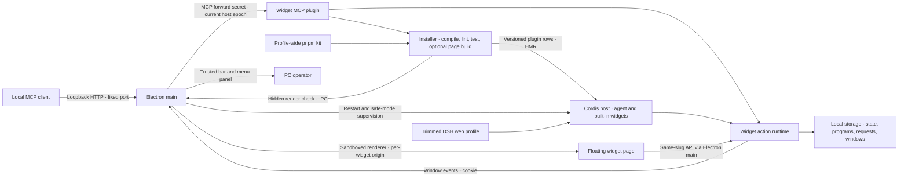
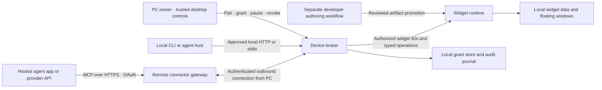

# deepWidgets architecture review

28 November 2026 · `main` at `f158c36f14`

The [follow-up decision and development review](decision-history.md) adds three independent passes and corrects two conclusions below. A widget can cross the window geometry controls through a separate renderer path, and packaging has specific unresolved dependency and kit blockers.

The [product direction](../../specs/product-direction.md) places the local agent-to-person loop first. The sequence in section 5 applies when planning a hosted connector. [Ephemeral surface proposal](ephemeral-surface-design.md)

## Verdict

**deepWidgets has a solid local widget architecture. It does not yet have the authority model needed for a remote connector.** The valuable product is a set of user-owned desktop widgets that any compatible agent can operate under the PC owner's rules. The widget runtime, shared action model, window ownership and crash recovery are worth building on. A generic tunnel to the current MCP port would carry away the assumptions that make that port acceptable for trusted local development.

The biggest change since the November 3 consent decision is that agent capabilities became more powerful while consent stayed deferred. A local caller still gets a token without approval. Privileged tools default on, including when the settings file is unreadable. The server accepts executable widget code from a folder on the PC, runs it during validation, and loads it into the shared Cordis host. Those facts combine into one architectural blocker. Fixing only transport, only OAuth, or only dependency linting leaves it intact. [MCP consent decision](../../../docs/specs/mcp-consent.md) · [Current token issuer](../../../deepwidgets/mcp/src/index.ts#L1093) · [Mode defaults](../../../deepwidgets/mcp/src/index.ts#L234) · [Creation gates](../../../deepwidgets/mcp/src/creation.ts#L399)

I found **no positive evidence of deliberate sabotage, monetization-driven degradation, or provider lock-in introduced by these changes**. I found two documented permissive decisions, one explicitly deferred consent program, and a release-assurance gap. Their consequences are real even without bad intent. The strongest evidence in the opposite direction is that the work removes upstream telemetry rows from the intended runtime, gives operators independent window controls, and preserves widget data and user choices across many ordinary replacements.

## 1. Architecture in the checkout

| Part | What actually owns it |
| --- | --- |
| Desktop shell | Electron main owns the public-facing local listener, the child host lifecycle, the menu bar and floating windows, the widget asset protocol, and a separate native-controlled view for the hover bar. The usual host web listener gets an OS-assigned loopback port. Electron's fixed listener stays bound when the host restarts and can say the current host is unavailable. The CLI test/development path has its own listener and skips the Electron render check. |
| DSH and Cordis | The loaded profile is a trimmed DSH Web composition. Boot, credentials, storage, domain validation, fetch routes, HMR, timers, plugin manager, locale and diagnostic rows still matter. Most model, agent, session and tool functionality is disabled or pending. The retained upstream `remote-access` policy is for Typert Gateway methods and events. The widget MCP handler has its own direct route and authorization logic. The old DSH renderer still loads and remains hidden on macOS. |
| Widget runtime | `ctx.widgets` makes the UI and MCP use the same registered actions, schemas, storage, revisions and change signals. This is the product's strongest seam. The runtime owns per-slug mutations and request accounting. The widgets storage domain has a shared write chain. Agent handlers execute in Cordis alongside built-in code. The state, program and window visibility live separately from the installed source. |
| Rendering | The pinned shell mounts an OpenUI catalog. A custom page can add React components through the widget kit. Electron serves it under the widget's origin, with same-slug API forwarding, CSP headers and a sandboxed renderer. The render check loads a staged artifact in a hidden window. A live page gets one reload before falling back to the shared shell after a second failure within 60 seconds. |
| Operator controls | The macOS panel has widget status and state, Show/Hide, Turn on/Turn off, Remove, settings and kit management. MCP hides the built-in `main`. Window visibility is durable. The November 28 merge adds drag, layer and lock in an independent view, with position/layer/lock in Electron memory for this first unit. Persisted geometry, operator-chosen fields, agent window tools and screenshots are later units. |
| Creation and updates | Local MCP hands the installer a source directory. It stages and builds host code and, optionally, a page. The plugin manager hot-loads a replacement and preserves a usable old version on tested failure paths. The selected page is a separate filesystem link. The kit manages package resolution and page build dependencies. Profile seeding adds template bundles previously unseen by that profile. |
| Failure and operations | A watchdog and crash attribution let Electron restart the shared host, quarantine an implicated widget, or start safe mode after repeated unblamed failures. Crash diagnostics are distinct from the live change feed. The host exports widget logs to stdout. It has no maintained packaged-app log file for those lines. Probe and trace help development. |

Evidence for the map. [Expected host composition](../../../deepwidgets/trim/rows.host.txt) · [DSH architecture](../../../docs/architecture.md) · [DSH remote-access scope](../../../packages/api/remote-access/README.md) · [Desktop MCP port](../../../docs/specs/safe-host.md#L43) · [Widget runtime spec](../../../docs/specs/widget-mvp.md#L29) · [Widget page serving](../../../docs/specs/agent-library.md#L127) · [Main widget](../../../docs/specs/main-widget.md#L63) · [Window-manager delivery sequence](../../../docs/plans/window-manager.md#L5)

## 2. Findings

P0 blocks a remote pilot. P1 needs explicit treatment before broader rollout or before the named capability ships. P2 is product and platform design work.

### P0 · Consent exists in the spec and is missing from the running path

Electron and the host check loopback, reject browser-shaped requests, and protect the private desktop-to-host hop. The nonce proof authenticates the server to a cooperating client. The requester's supplied agent label and the issued bearer do not establish operator approval. Grants are neither widget-scoped nor action-scoped. The operator can switch global creation and library modes, but Interact is always on, and a settings read/parse error restores both privileged modes. Restart rotates tokens. It is an availability event, with no durable authorization decision behind it. [Current fence and token path](../../../deepwidgets/mcp/src/index.ts#L1065) · [Settings behavior](../../../deepwidgets/mcp/src/index.ts#L234) · [Operator settings spec](../../../docs/specs/main-widget.md#L137)

The consent work is real and unfinished. The proposed local flow had a Claude Code spike. The deferral register records the server, native dialog, approved-agent list and bridge as deferred. The deferral register points to an unpublished implementation. The checked-in specification and released behavior are distinct. The proposal grants everything to each approved agent and assumes a loopback callback. A remote, multi-client design needs finer grants and cloud OAuth callbacks, with final approval on the target PC. [Consent spec and client spike](../../../docs/specs/mcp-consent.md) · [Deferral register](../../../docs/explore/widget-system/where-we-stand.md#L212) · [MCP authorization](https://modelcontextprotocol.io/specification/2026-07-28/basic/authorization)

**Decision.** Preserve the local developer path only as explicit local development access. Put durable grant state in a trusted process or service adjacent to desktop main. A grant should bind an accountable connector/client, a user and device, a widget installation, and allowed actions or data views. Treat current global modes as feature switches. Missing or invalid policy denies remote access. Supply a local Pause remote access control and individual revocation that do not depend on a healthy widget host.

### P0 · Widget execution has the authority of the shared host account

A controller can become an author because MCP puts interaction, install, replacement and removal behind one token. The current authoring gates check compilation, types, lint, action startup and rendering. The test subprocess has a small heap, short runtime and reduced environment. It runs ordinary Node with OS-user filesystem and network authority. The live plugin runs in the shared Node/Cordis host. Cordis ownership and guarded services help cooperating plugins, and the watchdog recovers from some failure modes. These controls cannot enforce a grant against hostile plugin code in that process. A grant for one widget also depends on whether that widget's handler can read files, contact an arbitrary service or operate other widgets directly. [Creation pipeline](../../../deepwidgets/mcp/src/creation.ts#L399) · [Original full-Node decision](../../../docs/explore/widget-system/where-we-stand.md#L233) · [Safety notice](../../../SAFETY.md)

**Decision.** Ship remote use first for trusted bundled handlers or a declarative widget runtime. Keep remote install/reload/remove, package changes and arbitrary directories outside the first remote surface. Preserve advanced Cordis authoring as an explicit developer trust tier. For a later installable-widget tier, isolate both build/test and execution with OS-enforced filesystem, network and resource policy. Give widgets narrowly brokered storage or integration capabilities. A worker thread or ordinary Node child alone cannot provide that isolation. When remote creation is ready, submit an immutable bundle for review and promotion instead of asking the cloud client for a PC path.

### P1 · The remote action semantics can repeat a write after a reconnect

The local runtime has unusually careful handling of mutation settlement. It persists a write mark atomically with widget state, serializes conflicting mutations, distinguishes timeout before and after a write, and can report an unknown result after a crash. However, MCP passes the ID minted with the bearer as the runtime caller, a new handshake mints a different ID, and deduplication is keyed by caller plus request ID. If a mutation commits and the response is lost around host restart, retrying with the same ID through a fresh token falls outside the original key. The request ID is optional and default records expire after ten minutes. The storage guarantee covers widget-domain writes. Arbitrary filesystem or network side effects inside a handler have their own failure semantics. Per-widget serialization also feeds a shared domain write chain. An overloaded widget can increase write latency elsewhere, and the domain validates all records at open. Storage faults can therefore have a wider impact than a renderer failure. [MCP action and replay guidance](../../../deepwidgets/mcp/src/index.ts#L928) · [Token identity](../../../deepwidgets/mcp/src/index.ts#L1119) · [Runtime request keys](../../../deepwidgets/widgets/src/index.ts#L1209) · [Write-settlement design](../../../docs/specs/widget-fv.md#L7) · [Storage durability and open behavior](../../../packages/storage/storage-domain/README.md#L85)

**Decision.** Require operation IDs for remote mutations and bind them to the stable connector grant, device, widget installation, action and arguments. Set an explicit retry lifetime and a way to read a committed or unknown outcome. Use an expected revision for overwrite-style operations when appropriate. Budget per device and connector. On a disconnected or sleeping device, return a visible unavailable result and keep writes out of an offline backlog for the first release. For later external effects, use a downstream idempotency key or an explicitly reconciled workflow.

### P1 · A display name, a slug and a change cursor carry too much meaning

`widget_describe` can return the whole state and an absolute source path. The list and change feed filter out `main` but otherwise have no per-client visibility. The 1,000-entry feed lives in memory and resets on restart or cursor expiry. The widget page action route labels callers `user`, which also covers script-driven requests from the page. Widgets keep state when removed, and a later install using the same slug can take it back. Preserving state for a genuine replacement is valuable. With multiple creators or connectors, the slug alone is too weak to establish data ownership or continuity of approval. [Discovery and state export](../../../deepwidgets/mcp/src/index.ts#L906) · [Change feed](../../../deepwidgets/widgets/src/index.ts#L907) · [Page caller label](../../../deepwidgets/widgets/src/index.ts#L1348) · [Removal contract](../../../deepwidgets/mcp/src/index.ts#L977)

**Decision.** Give each installation a stable ID, with a separate version/digest and a human-readable slug. An approved compatible upgrade can retain grants for existing capabilities. New capabilities require renewed approval. An unrelated reinstall needs explicit opt-in to inherit old data. Let each widget declare deliberately shareable state projections, and check scopes on list, describe, action, changes and screenshots. Keep per-grant change cursors or clearly defined snapshot resync. Record a bounded, durable, local decision journal distinct from the UI feed. It should distinguish a trusted operator approval, a widget renderer request, a scheduled handler and a remote connector. Keep useful metadata while minimizing arguments and result content. Add export, backup and a clear Delete data operation with defined retention.

### P1 · The page you validate can differ from the page you activate

PR #115 deliberately changed import/output fences into warnings. This was recorded at merge, on the rationale that the host half already had full Node access. That rationale no longer holds when product policy promises data and permission separation. Origin isolation and CSP are useful at runtime. They do not confer build confinement or artifact provenance. The page build key hashes page source and a local kit version number. App upgrades repoint core package links without advancing the kit version. The installer can render-check newly built bytes and then retain older bytes under the same hash. Separately, a host bundle can commit before the page link is written. If the link write fails, the installer returns a warning after the widget has already changed. A newly active action schema may therefore meet an older interface. [Fence decision](../../../docs/specs/agent-library.md#L97) · [Core repointing](../../../docs/specs/kit.md#L42) · [Page hashing and reuse](../../../deepwidgets/mcp/src/page-gate.ts#L392) · [Host commit and page update](../../../deepwidgets/mcp/src/creation.ts#L1042)

**Decision.** Verify and publish the same artifact. Version the host program, page digest, catalog, action schemas, toolchain and dependency snapshot as one installed revision. Retain one last-known-good complete revision and recover via a single commit pointer or equivalent journal. Enforce the permitted inputs in isolated builds before allowing remote submissions. Keep sandboxed rendering, but include cross-origin access, native permission denial, navigation and the privileged operator panel in release tests. [Electron security guidance](https://www.electronjs.org/docs/latest/tutorial/security)

### P1 · The global kit exchanges convenience for package maintainer trust

The kit gives fast repeat builds, one version of React, exact direct extras, a lockfile, offline restore and fail-fast page builds during kit operations. The settings pane makes changes visible and reserves them for the operator. The pnpm project also explicitly enables all dependency build scripts, with a user-maintained package denylist and a 24-hour age floor. A dependency tree can change user files during install with the authority of the package-manager process. Age and a lockfile help with sudden upstream changes and reproducibility. They do not decide whether build scripts should have host access. Kit removal affects future builds. Already-bundled pages keep their bytes, and the kit retains only the last three versions without per-widget dependency pinning. [Kit decisions](../../../docs/specs/kit.md#L15) · [Generated build policy](../../../deepwidgets/kit/src/folder.ts#L89) · [Kit retention](../../../docs/specs/kit.md#L44)

**Decision.** Install package content with scripts disabled by default. For exceptional builds, approve the precise package/version/digest and run them separately with minimal authority. Track which widget build includes each dependency. Distinguish removing a future dependency from disabling or rebuilding deployed versions, and support a documented security-fix override. Pin or export the inputs for each installed artifact that operators need to reproduce.

### P1 · The shared host is a reliability dependency for permission and recovery

Crash attribution, bounded disposal and Electron-owned ingress are meaningful improvements. Recent work closes a real update/restart ordering issue. The failure domain still includes all agent host code, state reads and writes, operator settings logic and connector service. During restart, old views can remain on screen. Data or permissions displayed there can be stale. The tests and models cover meaningful install, action and lifecycle cases. They explicitly omit cases including the update-stop/unseen-exit ordering, and the notes still carry open built-in safe-mode behavior. A known renderer-load race is separately recorded as deferred. [Safe host design](../../../docs/specs/safe-host.md) · [State-model scope](../../../.agents/skills/widget-state-models/SKILL.md#L325) · [Main panel restart state](../../../docs/specs/main-widget.md#L203) · [Deferred renderer race](../../../docs/explore/widget-system/where-we-stand.md#L212)

**Decision.** Keep permission controls and the audit view independently usable when the widget runtime is restarting or disabled. Report a separate status for paired, connected, paused, sleeping/unreachable, degraded and revoked as appropriate. Identify the target host or device epoch on any pending operation. Check that the grant is current again before admitting work or releasing buffered results. Define the outcome if permission changes after an action has committed. Measure false quarantines, local responsiveness and recovery under realistic memory/CPU pressure and multiple windows before giving connectors automatic retry authority.

### P1 · The window controls are separate, and geometry authority needs enforcement

The hover bar uses its own view and IPC. The follow-up review found a pre-merge report that a page can bypass the native lock and resize constraints. Treat renderer separation and geometry enforcement as separate checks. The latest milestone is intentionally in-memory. The planned `chosen` rule is a sound default for persistent window policy. Planned screenshots are a distinct privacy permission even when they capture only the widget. A hidden or off widget, PC lock, session switch or disconnected display should have an explicit effect on remote observation. There is also a product distinction among hiding a window, suspending local execution and revoking remote access. The panel should say which one happened. [Bar and operator route design](../../../docs/specs/window-manager.md#L78) · [Planned screenshot scope](../../../docs/specs/window-manager.md#L140) · [Landed first unit](../../../docs/plans/window-manager.md#L5)

**Decision.** Finish operator-owned placement and persistence. Scope remote window layout and screenshots separately from data access. Keep trusted indicators and approval outside widget-controlled content. Test real monitor and workspace changes on each supported OS, including sleep/wake, focus, display removal and mixed scaling.

### P1 before distribution · A clean local prototype still needs a release identity

The October public-fork commit explicitly removed 27 upstream GitHub workflows, including packaging, CI and dependency automation, plus the upstream bots and templates. The checked-in GitLab pipeline is inherited and includes upstream Python publishing jobs. The repository has many useful local checks. I found no replacement GitHub Actions configuration in the tree and could not establish independent hosted or branch-protection status from the checkout. The README describes a source-only, primarily Mac product, with inherited Windows packaging and incomplete Linux distribution. Electron main still supports inherited update and mandatory-policy mechanisms when enabled by build or development configuration. This is a material product ownership surface before signing and distribution, with no evidence here that a mandatory service is enabled for the ordinary source run. [Public-fork history](https://github.com/Ronitron007/deepWidgets/commit/36aa16359557b4cf8999160d41109bb16cdf6a03) · [Upstream import notes](../../../UPSTREAM.md) · [Inherited pipeline](../../../.gitlab-ci.yml) · [Platform support](../../../README.md#L55) · [Update and policy setup](../../../apps/desktop/src/main.ts#L1584)

**Decision.** Keep the upstream vendor branch and retained reference code. Test the effective runtime allowlist and declared network destinations on clean and migrated profiles when syncing upstream. Establish fork-owned app identity, signed artifacts, a controlled update feed, a reviewable update policy, and platform-specific install and upgrade tests before a wider remote rollout. Restore focused CI sized to the fork. Include clean and old-profile boots, actual Electron window behavior, core recoveries, dependency build policy, and broker permission tests. The profile's existing “never re-add an explicitly removed bundle” design is worth preserving and testing under damaged-record and interrupted-upgrade recovery. [Upstream sync method](../../../docs/plans/upstream-sync.md) · [Profile bundle reconciliation](../../../apps/desktop/src/deepwidgets-profile-bundles.ts#L48)

## 3. Foul play and product degradation

| Signal | What the evidence supports |
| --- | --- |
| Checks missing from GitHub | A documented cleanup at public-fork setup. The missing replacement weakens assurance. The history does not show an attempt to hide that removal. Commit `36aa163595`. |
| Page gates visibly weakened | The behavior is real and documented. PR #115 adopted warnings and kept other checks. The rationale depended on a trusted full-Node authoring model. Remotely authored widgets make the trade-off obsolete. |
| Extra packages can run build scripts | Explicit operator decision in the kit spec and explicit in the generated workspace. An unsafe default for a general audience, with no evidence of an undisclosed change in intent. |
| Consent behind the product roadmap | The November 3 decision exists, implementation is locally in progress, and subsequent work shipped broader capability ahead of it. That is the clearest case of product priorities drifting from the proposed trust promise. |
| Upstream telemetry, updates and branding | The intended trim disables known account/product/session telemetry rows. The desktop still contains inherited conditional update, welcome and analytics paths. I found no repository evidence of a newly imposed provider account, forced hosted relay or monetization funnel. This was a source and composition review. I did not measure all egress from a packaged artifact. |
| Provider dependence | The widget spine is provider-neutral. A single proprietary relay, provider-only authorization or hosted-only export path would create a future dependency. Keep the device grant model and local widget data under the operator's control, with interchangeable or self-hosted relay options. |

Sources for those judgments. [Trim telemetry rows](../../../deepwidgets/trim/cordis.patch.yml#L439) · [Deferred consent and packaged logs](../../../docs/explore/widget-system/where-we-stand.md#L212) · [Fence decision](../../../docs/specs/agent-library.md#L97) · [Kit decisions](../../../docs/specs/kit.md#L15)

## 4. Architecture for agents anywhere

**MCP is the app-facing protocol.** Design one supported Streamable HTTP endpoint and a local stdio/HTTP adapter where useful. Keep the policies in a transport-independent broker. Use standard discovery, OAuth 2.1, PKCE where applicable, and audience-bound tokens. Verify the current MCP specification against real clients. Its current July 2026 revision prefers client ID metadata documents and retains dynamic registration for compatibility. That matters because several clients still document dynamic registration and the November local spike assumed it. Use authenticated device pairing, narrowly scoped routing and a distinct PC credential. A credential identifying the relay or provider account cannot stand in for the PC owner's grant. Prefer a local authorization server or a gateway design in which a relay operator cannot mint device authority unilaterally. [MCP versioning](https://modelcontextprotocol.io/docs/2026-07-28/learn/versioning) · [MCP authorization](https://modelcontextprotocol.io/specification/2026-07-28/basic/authorization) · [MCP security guidance](https://modelcontextprotocol.io/docs/2026-07-28/tutorials/security/security_best_practices)

**The PC stays authoritative.** Run the broker outside the process with agent-installed code. Let an authenticated cloud connector request a pairing or grant, and let the PC show what is proposed. For example, “Claude for the personal account can read the Grocery list and add items on this Mac for seven days.” Use the narrowest identity the provider actually attests. A provider connection often cannot verify which model or chat originated a particular call. Use separate starter grants for read and update, and per-use confirmation when a privilege or effect warrants it. Filter data at the PC. A public HTTPS gateway that terminates MCP can ordinarily see request and response bodies. Be explicit about that visibility and the destination's logging or retention. Offer the same managed or self-hosted HTTPS gateway protocol for hosted clients. A private overlay works for clients the user controls, and an optional vendor tunnel can serve that vendor’s own clients. Gateway choice changes who can see traffic. A model provider still receives the tool data sent back to it.

**Keep the first tool surface small and predictable.** Retain the advantage of stable tool schemas across thousands of widgets. Give the connector clearly separate discovery, read, mutation and operation-status tools so a provider can authorize and describe them accurately. Expose only authorized widgets and projected fields. Keep cursor polling and snapshot resync as the baseline. Make push an optional provider capability after opt-in and filtering. Treat model-visible widget content as data. Widget labels, text and screenshots do not confer permission. Expose structured action metadata and effect summaries for meaningful consent.

**Provider choice is an app capability matrix.** “Every model” is viable when the runtime calling the model can execute tools. “Every official chat app” depends on what that app allows.

| Surface | Practical fit |
| --- | --- |
| OpenAI ChatGPT, Codex and Responses API | Test the documented custom HTTPS connector in eligible surfaces and private Secure MCP Tunnel as an optional adapter. ChatGPT's write availability depends on workspace and plan. The tunnel has its own organization/workspace policy and is unavailable for public plugin distribution. [ChatGPT custom MCP connections](https://help.openai.com/en/articles/12584461-connecting-custom-mcp-servers-in-chatgpt) · [OpenAI API MCP](https://developers.openai.com/api/docs/guides/tools-connectors-mcp) · [Secure MCP Tunnel](https://developers.openai.com/api/docs/guides/secure-mcp-tunnels) |
| Claude and Claude Code | Claude custom remote connectors originate from Anthropic's cloud, even when configured in Claude Desktop. The local client route is separate. Claude Code supports MCP HTTP and stdio. Claude API supports a remote connector. [Claude remote connectors](https://support.claude.com/en/articles/11175166-get-started-with-custom-connectors-using-remote-mcp) · [Claude Code MCP](https://code.claude.com/docs/en/mcp) · [Claude API connector](https://platform.claude.com/docs/en/agents-and-tools/mcp-connector) |
| Google Gemini and Microsoft | Gemini CLI supports local stdio and remote HTTP with OAuth. Use a client-side tool host with the Gemini API where appropriate. Validate Copilot Studio's documented Streamable HTTP OAuth support as an enterprise connector surface. These records establish those surfaces' capabilities. [Gemini CLI MCP](https://geminicli.com/docs/tools/mcp-server/) · [Gemini API function calling](https://ai.google.dev/gemini-api/docs/function-calling) · [Copilot Studio MCP](https://learn.microsoft.com/en-us/microsoft-copilot-studio/mcp-add-existing-server-to-agent) |
| DeepSeek API and other function-calling models | A nearby agent host or tool adapter can invoke MCP on the model's behalf. The DeepSeek tool docs describe client-executed calls. Native custom connectors in consumer apps require independent product-specific verification. [DeepSeek tool calls](https://api-docs.deepseek.com/guides/tool_calls/) |

## 5. Delivery order and acceptance

| Order | Slice | Acceptance |
| --- | --- | --- |
| 1 | Local consent and broker | An unpaired caller has zero widget access. Two client grants can see different widgets and fields. A native revoke affects subsequent admissions and closes subscriptions while the widget host is down. Corrupt settings leave the protected route closed. The user can see grant history and pause all connector access from the PC. |
| 2 | One narrow remote vertical slice | A known bundled widget works in one hosted connector and one independently implemented client. Read and one useful mutation suffice. The PC initiates connectivity and stays authoritative. Device sleep, app exit and tunnel loss yield clear availability. A disconnect after commit followed by retry under a renewed credential changes state once. Rate limits, simultaneous operators and version mismatch have defined outcomes. |
| 3 | User ownership and operations | Audit and export work offline. Restore preserves stable installation identity where intended. Two PCs never receive each other's actions. Connector revocation and a relay switch have independent tests. Windows and Linux support claims follow tests on those OSes. Signed builds survive update, rollback and old-profile recovery with grants and their exclusions intact. |
| 4 | Advanced capabilities | Add screenshots and layout behind distinct grants. Add remote creation only after the build, test and runtime confinement demonstrate that widget code can touch only approved data, integrations and resources. Install and rollback preserve a coherent widget revision. |

The first demo I would build is a household list or desktop timer. Pair two clients with different rights, operate the widget from another network, show the change on the PC, revoke one client while the app is restarting, and confirm the other client and local UI keep working. Then repeat the write with an interrupted response. This tests the core promise of provider-neutral, owner-governed control with minimal dependence on widget authoring or package policy.

## 6. Evidence and limits

- Read the fork guidance, relevant DSH architecture and effective trim lists, core widget/MCP/kit paths, Electron startup, windows and supervisor, published specs, plans and bounded state models. Compared first-parent history back through the OAuth decision and the initial public-fork workflow removal. Reviewed the running-product boundaries and inherited paths that affect them.
- The focused desktop command `corepack pnpm exec vitest run apps/desktop/tests/deepwidgets- apps/desktop/tests/main-startup.spec.ts` finished with **225 passed and 1 skipped across 9 files**. These include stubbed Electron and host checks. A separate rerun of `apps/desktop/tests/host-process.spec.ts` with loopback access passed all **29 tests**. The widget-kit import separation check passed. The inspector helper check passed with loopback access after it timed out in the sandbox. The broad desktop suite had **2,004 passed, 63 failed and 64 skipped** in this environment. It encountered loopback listener, IPC, process and home-write `EPERM` failures and used Node 24.8.0, below the documented 24.9 minimum. I did not classify the remaining failures as regressions from those results.
- The shared desktop smoke lock was already held, so I did not start a competing GUI or Host smoke. I read the formal models and their documented limits without rerunning TLC. Provider capability evidence comes from current first-party documentation. I did not pair live provider accounts, run a packaged installer, inspect private CI settings or perform a packaged egress capture. I made no source changes.
