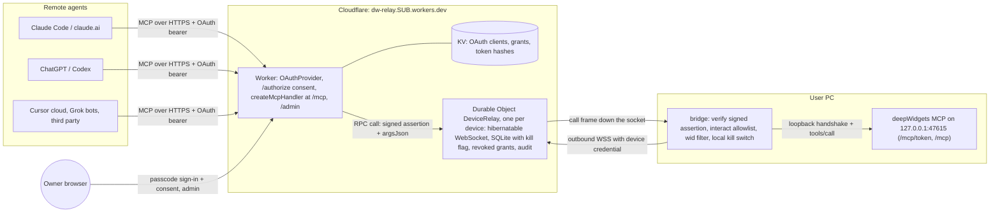

# deepWidgets remote access on Cloudflare: architecture, round 3 (final)

Status: round-3 final, 28 Nov 2026. Inputs: `mapping.md`, the three lenses in `lenses/` (`cloudflare-ops-blimey.md`, `prior-art-scout.md`, `security-goosebump.md`), `cloudflare-facts.md`, `critique-r1-sonnet.md` and `critique-r2-sonnet.md`. Library claims were checked against the type definitions in `prototype/node_modules` (paths below are relative to it). Anything not confirmed there or in the inputs is marked "verify".

## Revision history

### Round 1: Opus draft
- Compared Tunnel + Access (A), DO relay + OAuth (B) and a hybrid (C); picked B for interact-only, two enforcement points and `workers.dev` with no DNS.
- Made the remote path interact-only and added a per-call Ed25519 assertion that the bridge re-checks on the PC.
- Put both kill switches outside `settings.json`, chose fail-fast over queueing, costed 100k devices and wrote a first build spec.

### Round 1: Sonnet critique
- Found a wrong MCP handler import, a wrong `/mcp/token` 404 mechanism and a missing `resourceMetadata`.
- Found cross-widget reads through `widget_list` / `widget_changes` and a bridge that trusted relay time.
- Asked for a lockout on `/admin/*`, `revokeExistingGrants: false`, and a smaller MVP (no CIMD, no hand-written consent form).

### Round 2: Opus revision
- Fixed the handler (`agents/mcp/server`), the `/mcp/token` 401/404 pair and `resourceMetadata`, each checked in `node_modules`.
- Added the `wid` filter, the `secret` fixture and own-clock time checks; `hello` lost `serverTime` (a frame protocol change).
- Used the provider's consent helpers, cut CIMD and the rate-limit binding, split the e2e into suites A and B.
- Kept newest-wins bridge replacement and the stub on SDK 1.32.2.

### Round 2: Sonnet critique
- `grantId` cannot be passed in `completeAuthorization` props, and `timeoutMs` is not a `widget_call` input (N1, N2).
- Audit rows and device revoke were promised but not built; the bridge ceiling and args cap were missing from section 14 (N3, N3b).
- The real-server smoke run contradicted the Phase 0 exit; a global lockout could be turned on the owner (N4, N6; removed in the build, see section 15); props were unchecked (N5).
- Pushed back on newest-wins replacement and proposed MVP cuts and open-question edits.

### Round 3: Opus final
- `grantId` comes from `tokenExchangeCallback` via `accessTokenProps` (N1); props are shape-checked, `allowedHostnames` comes from `PUBLIC_URL`, Origins get 403 (N5).
- Fixed 60 s DO wait; the bridge's local timeout is the action's `timeoutMs` from `widget_describe` (N2).
- Audit promise cut to what is built; `GET /admin/grants` back; device credential is a Worker secret with a rotate step, no mint (N3, N3b); smoke run in Phase 0 (N4).
- Lockout per IP with a global fallback and a break-glass step (N6; the global fallback was dropped during the build after the code critique, see section 15); a new bridge socket is refused while the old one answered a ping within 45 s.
- MVP cuts: DO rate buckets, the `slow` retry test, the two-grants test, the device-id MAC; open questions edited.
- Frame protocol unchanged in round 3; assertion claims unchanged (`gid` is now filled from the access-token props).

## 1. Summary

Recommendation: a small bridge on the PC dials out over a WebSocket to a Cloudflare Worker, and each device gets one Durable Object that holds that socket.
Agents never reach the PC directly. They talk standard remote MCP to the Worker at a `workers.dev` address and sign in with OAuth 2.1 + PKCE (pre-registered clients now, CIMD later, no open DCR).
The remote path is interact-only: agents can list, read, call and watch widgets that already exist; they can never install, reload or remove widget code, because that code runs unsandboxed and a remote install would be remote code execution.
For every tool call the Worker signs a short-lived Ed25519 assertion (tool, args hash, scope, widgets, client, expiry, one-time id); the bridge checks it again on its own clock before it touches deepWidgets, so a bug or breach in the cloud alone cannot widen access.
If the PC is offline the call fails fast; nothing is queued. A kill switch lives in the cloud and on the PC, never in deepWidgets' agent-writable `settings.json`.
No cloudflared, no DNS changes, no Cloudflare account per user; about $5/month for one owner and a few hundred dollars a month at 100k devices (section 8).

## 2. Options compared

What every option must work around (from `mapping.md`):

- The MCP port binds `127.0.0.1` only and refuses non-loopback peers, any `Origin`, and any non-loopback `Host` (`ref/apps/desktop/src/deepwidgets-mcp-port.ts:219`, `:91-102`).
- Any local caller gets a bearer from `POST /mcp/token`; the HMAC proof only proves the server to the client (`ref/deepwidgets/mcp/src/index.ts:1093`, `ref/deepwidgets/mcp/README.md:161-165`).
- Token scopes are empty; the token only names the caller (`ref/deepwidgets/mcp/src/index.ts:1163`).
- `create` mode installs agent code that runs in the Host with full Node rights (`ref/docs/explore/widget-system/where-we-stand.md:237`, `:256`). Remote `create` is RCE.

### Option A: cloudflared Tunnel per device, fronted by Access

- **How it works.** Each PC runs `cloudflared` with a named tunnel; a public hostname routes to a local listener; Access sits in front, deny by default. Agents use an Access service token or an Access login.
- **Auth.** Access decides who reaches the hostname but cannot see MCP tool names, so no per-tool or per-widget scope. Behind the tunnel the local fence is meaningless: cloudflared is a loopback peer and a rewritten `Host` passes, so `/mcp/token` would mint tokens for anyone past Access (security-goosebump R2). A separate interact-only gateway with Access JWT validation would be needed on the PC.
- **Latency and ops.** No stateful hop; probably the lowest latency (unmeasured). Ops burden high per device: run `cloudflared` (admin rights for a service), create tunnels, DNS records, Access apps and service tokens per device by API. Needs a domain on Cloudflare, which breaks "workers.dev, no DNS". Intel macOS and 32-bit Windows builds drop in 2027 (`cloudflare-facts.md`).
- **Cost at scale.** 1,000 tunnels included, then $4.50 per tunnel per month, inactive ones included (`cloudflare-facts.md`): about $445,500/month at 100k devices, plus Access seats if end users count (verify).
- **Failure modes and iPhone.** Connector down gives an edge 5xx with no device semantics; a leaked tunnel token runs a rogue connector (security-goosebump R8); mis-pointed ingress exposes the whole Host web app. Fine for a human in Safari, poor for agents.

### Option B: outbound WebSocket to a Worker and one Durable Object per device, OAuth 2.1 in front (recommended)

- **How it works.** A bridge on the PC opens `wss://dw-relay.<subdomain>.workers.dev/device/connect` with a device credential. The Worker routes the upgrade to the device's Durable Object, which accepts it with the Hibernation API. Agents call a stateless MCP endpoint `/mcp` on the same Worker, which forwards each allowed call via the DO and the socket to the bridge, which verifies it and calls deepWidgets on loopback.
- **Auth.** OAuth 2.1 + PKCE via `@cloudflare/workers-oauth-provider` with our own `/authorize`; no open DCR. Encrypted grant `props` (owner, device, scopes, widgets) arrive with each request. Per-call signed assertion checked by the bridge. The device has its own credential, separate from agent tokens.
- **Latency.** One extra stateful hop (DO) versus A. A DO stays where it was first created, so create it on the bridge's first connect. Expected tens of ms; India placement unmeasured.
- **Ops burden.** Low: one Worker, one DO class, one KV namespace. No per-device Cloudflare objects, no binary, no DNS. We own pairing, consent and revocation code.
- **Cost at scale.** About $5/month up to about 1k devices; about $310/month at 100k (section 8). Hibernation is mandatory: non-hibernating sockets would cost about $207k/month at 100k devices (cloudflare-ops-blimey).
- **Failure modes.** Bridge offline gives `device-offline` at once. Deploys drop sockets, so the bridge reconnects with jitter. A DO or Worker bug could widen access, which is why the bridge re-checks every call. KV is eventually consistent (about 60 s), so revocation also lives in the DO.
- **iPhone fit.** Good: the same Worker can sign in the iPhone app and send APNs pushes; the phone is a push target, not a socket peer (section 9).

### Option C: hybrid (Worker OAuth gateway, then Tunnel + Access service token to the PC), and other variants

- **How it works.** security-goosebump's design: OAuth at the Worker as in B, but the Worker reaches each PC through a per-device tunnel behind Access with a service token and a signed header, validated by an interact-only gateway on the PC.
- **Auth, latency, ops.** Strongest on paper, but Access adds little over B's device credential and signed assertion, because the Worker is the only caller either way. Latency like A plus the Worker hop. Highest ops burden: all of A plus B's Worker side.
- **Cost, failure modes, iPhone.** Tunnel economics as A (about $445,500/month at 100k; Workers VPC, in beta, still needs a tunnel per device). Two connection systems; offline detection only from tunnel health. iPhone as B.

Other variants dropped: **Access service tokens only** (no scopes, long-lived static secrets, hosted agents speak OAuth); **Cloudflare Mesh** (per-seat client on every participant, needs a non-loopback bind, does nothing for cloud agents); **HTTPS long-poll** instead of a WebSocket (prior-art-scout 6.1; higher latency and more requests than a hibernating socket).

## 3. Decision

| Criterion | A: Tunnel + Access | B: DO relay + OAuth 2.1 | C: Hybrid (OAuth + Tunnel) |
|---|---|---|---|
| Works with claude.ai / ChatGPT remote MCP | Only with a gateway added | Yes, native OAuth 2.1 | Yes |
| Per-tool and per-widget scopes | No (Access is coarse) | Yes, at Worker and bridge | Yes, at Worker and gateway |
| Keeps `/mcp/token` and create tools unreachable | Only with extra gateway | Yes: exact MCP route, tools never registered, bridge allowlist | Yes, with extra gateway |
| Extra install on the PC | cloudflared (admin rights) | None (bridge ships in the app) | cloudflared (admin rights) |
| DNS / domain needed | Yes | No (`workers.dev`) | Yes |
| Moving parts | Tunnel, Access, gateway, provisioning | Worker, one DO class, KV | All of A plus B's Worker |
| Cost at 100k devices (rough) | ~$445k/month | ~$310/month | ~$445k/month |
| Offline detection | Coarse (edge 5xx) | Exact (socket attached or not) | Coarse |
| Latency | Lowest | One extra DO hop | Like A plus Worker hop |
| iPhone / Live Activities fit | Weak | Good (same backend sends APNs) | Like B |

Recommendation: **Option B.** It is the only option that meets the hard requirements (interact-only, two enforcement points, `workers.dev` with no DNS changes) without shipping a third-party binary or paying per device. Its costs are one extra hop and owning the auth code. A is acceptable only as a throwaway one-owner demo; C adds parts without adding much protection over B's signed assertion.

## 4. Recommended architecture



### Components

- **Worker `dw-relay`** on `dw-relay.<subdomain>.workers.dev`, no custom domain, no DNS, `preview_urls: false`. Routes: OAuth discovery and `/token` (provider), `/authorize` (our sign-in and consent), `/mcp` (stateless remote MCP via `createMcpHandler`), `/device/connect` (bridge upgrade), `/admin/*` (owner-only). `/mcp/token` on the Worker gets 401 without a token (the provider treats `/mcp/*` as API) and 404 with one (the handler serves only `/mcp`).
- **Durable Object class `DeviceRelay`**, one per device. It accepts the bridge socket with `ctx.acceptWebSocket()` so it hibernates between calls (`cloudflare-facts.md`), and answers a literal `ping` text with `pong` via `setWebSocketAutoResponse` (in `@cloudflare/workers-types`) so keepalives do not wake it. SQLite holds the kill flag, revoked grant ids and a bounded audit table; lockout counters live in a separate `Lockout` DO.
- **KV namespace `OAUTH_KV`**, required by the provider for clients, grants and token hashes. Never the only revocation check.
- **Not in the MVP.** D1, Queues, R2 (fleet-scale audit batches, cloudflare-ops-blimey section 5). Access / Zero Trust: only for the operator's admin surface, later; not for agents or end users (seat cost, no tool visibility).
- **Bridge** on the PC. Prototype: a Node 24 daemon. Product: a module in Electron main, which owns the MCP port and is out of reach of widget Host code. It holds the device credential, dials out, verifies each assertion, enforces its allowlist, `wid` filter and kill switch, and forwards to deepWidgets as a genuine local client; no fence is loosened.

### Request lifecycle of one agent tool call

Example: Claude Code calls `widget_call` with `{ slug: "groceries", action: "add", args: { item: "milk" }, requestId: "r-1" }`.

1. The agent sends `POST /mcp` (`tools/call widget_call`) with `Authorization: Bearer <access token>`.
2. The provider validates the token against KV and the resource URL, decrypts the token `props` (`owner`, `deviceId`, `scope`, `widgets`, plus `grantId` from `tokenExchangeCallback`) into `ctx.props`. A bad token gets `401` with protected-resource metadata.
3. `createMcpHandler` calls our factory, which shape-checks `getMcpAuthContext()?.props` (zero tools if it fails) and registers only the tools the scope allows. The handler re-checks scope, that `groceries` is in `widgets`, and that the slug is not `main`.
4. The Worker serialises the arguments to `argsJson`, hashes the exact bytes with SHA-256, and signs an Ed25519 assertion (`aud = deviceId`, tool, args hash, scope, `wid`, client, grant, `iat`, `exp = iat + 30 s`, random `jti`).
5. The Worker calls the device DO over RPC with `{ grantId, assertion, argsJson }`. The DO checks the cloud kill flag and the revoked-grant set. No bridge socket: `device-offline` at once.
6. The DO sends a `call` frame down the socket and waits a fixed 60 s for the matching `result` frame.
7. The bridge verifies the assertion on its own clock: signature against the pinned public key, `aud`, `exp`, issued after bridge start, unseen `jti`, tool in its literal allowlist, scope covers the tool, SHA-256 of `argsJson` equals `ah`, slug in `wid` and not `main`, args at most 64 KiB, under 120 calls/min, local kill switch off. Any failure: a refusal code and a local log line.
8. The bridge ensures a local session: reads `$DSH_HOME/deepwidgets/mcp.json`, sends `POST /mcp/token { agent: "remote:<client>", challenge }` on loopback, checks `proof = HMAC-SHA256(nonce, challenge)` (`ref/deepwidgets/mcp/src/index.ts:1119-1121`, `ref/deepwidgets/mcp/README.md:41-45`), caches the token per client and Host start.
9. The bridge sends `tools/call widget_call` to `http://127.0.0.1:47615/mcp`. deepWidgets records the remote client in `by` (`ref/deepwidgets/mcp/src/index.ts:928-937`). It times out locally after the action's `timeoutMs` from `widget_describe` (`:913`). On `401` it re-handshakes once; on `503` it answers `device-busy`; on `502` for a mutation it answers `outcome-unknown` and never retries (`ref/apps/desktop/src/deepwidgets-mcp-port.ts:8-10`, `:296-299`).
10. The bridge filters read results by `wid`, strips `source` paths, caps the size and sends a `result` frame. The DO writes one audit row (time, client, grant, tool, slug, action, args hash, outcome, duration; never args) and returns to the Worker, which returns the MCP result.

## 5. Auth and permission model

### Device pairing

- **Product (Phase 1).** The desktop app shows a one-time pairing code (8+ characters, 5 min, single use) or QR; the owner enters it on the Worker. The bridge gets a device id, a credential (with a Worker-keyed MAC of the device id) and the assertion public key, and keeps the credential in the OS keychain (Electron `safeStorage`), never in `settings.json` or argv.
- **Prototype.** One device, no mint endpoint. The device id and the SHA-256 of a random credential `dwd_<32 random bytes>` are Worker secrets (`DEVICE_ID`, `DEVICE_CREDENTIAL_SHA256`); the Worker compares the hash in constant time and routes `/device/connect` only to the DO named `DEVICE_ID`, so no caller can create other DOs. Each grant is bound to one device at consent.

### Agent authorization: OAuth 2.1 versus keys

- **Default: OAuth 2.1 authorization code with PKCE (S256)** for every agent that supports remote MCP auth. The Worker is the authorization and resource server; tokens bind to the exact `/mcp` resource URL in `resourceMetadata.resource`.
- **Client identity.** MVP: pre-registered clients created by the owner via `/admin/clients` (`createClient`) with exact redirect URIs. Phase 1: CIMD for claude.ai and ChatGPT (prior-art-scout 1.2, 1.3) via `clientIdMetadataDocumentEnabled` (needs `global_fetch_strictly_public`); unproven until a deployed test, as local `wrangler dev` cannot serve a public client-id document.
- **No open DCR.** Open registration lets anyone create a client named "Claude" and phish the owner, and some clients register on every connect (prior-art-scout 1.2). No `clientRegistrationEndpoint` is configured (`oauth-provider.d.ts:1005`: only then is DCR implemented); the e2e asserts discovery has no `registration_endpoint` and `POST /register` is not 2xx. If a must-have agent only speaks DCR, add owner-gated registration later.
- **API keys and service tokens.** Not used as agent credentials (edge-only, no scopes, static). Phase 2 may add owner-minted agent keys for headless bots: hashed, bound to one device, scope and widget set, 90-day expiry, same assertion path. The provider's `resolveExternalToken` hook (`oauth-provider.d.ts:1097`) can map such a key to props (verify in a spike).
- **Consent screen.** Built with `beginConsent` / `approveConsent` / `denyConsent`; shows what `describeConsent` returns (client name, redirect host, local-app flag, scopes) plus the client id, target device and a widget field. Nothing is granted without the owner passcode.

### Scopes and widget limits

| Scope | Tools | Meaning |
|---|---|---|
| `widgets:read` | `widget_list`, `widget_describe`, `widget_changes` | See allowed widgets, their actions, state and changes |
| `widgets:call` | `widget_call` | Run an action of an allowed widget (includes mutations) |
| (none, ever remote) | `widget_install`, `widget_reload`, `widget_remove`, `widget_template`, `widget_guide`, `library_template`, `deepwidgets_modes` | Never registered on the remote path |

- **Interact-only is structural, not a setting.** The remote server never registers `widget_install`, `widget_reload`, `widget_remove`, `widget_template`, `widget_guide` or `library_template`, whatever the grant says. The bridge allowlist is a literal list of four tools: `widget_list`, `widget_describe`, `widget_call`, `widget_changes`. Reason: Host code has full Node rights (`ref/docs/explore/widget-system/where-we-stand.md:237`), so a remote install is RCE. `deepwidgets_modes` is left out too (reveals the settings path).
- **Widgets.** Each grant carries a widget list (`["groceries"]` or `"*"`), signed into the assertion as `wid`. `widget_list` and `widget_changes` take no slug and return every widget (`ref/deepwidgets/mcp/src/index.ts:910`, `:943-945`), so the bridge filters their results by `wid` and refuses `widget_describe` outside it. `main` is always refused (`ref/deepwidgets/mcp/src/index.ts:20-21`). Product default: none ticked.
- **"Draw".** No remote draw scope. Drawing means `create` today; the clean path is an owner-installed canvas widget whose action takes an OpenUI Lang program (data, not code), so `widgets:call` on it is "draw" (open question).
- **Rate limits.** Bridge: 120 calls/min per device; args 64 KiB, results 256 KiB. DO per-grant buckets wait for Phase 1.
- **Lockout** on `/authorize` and `/admin/*` (a `Lockout` DO): 5 failures in 15 min from one IP (`CF-Connecting-IP`) lock that key out for 15 min. The key is the IPv4 address or the IPv6 /64. There is no global counter: it would let a few sources lock the owner out. Check-and-count is one atomic `Lockout.attempt(key, ok)` call, and `/admin/kill` is never lockout-gated (it still needs the passcode).
- **Break-glass.** If an attacker locks the owner out of `/admin` (and so the cloud kill switch), `wrangler delete` (or delete the Worker in the dashboard) ends all remote access at once.

### The per-request signed assertion

The Worker signs, and the bridge verifies, one assertion per call: a compact JWS (`alg: EdDSA`, `kid`) with these claims:

```json
{ "v": 1, "iss": "dw-relay", "aud": "dev_7f3a9c", "sub": "owner",
  "cid": "<client id>", "gid": "<grant id>", "scope": "widgets:read widgets:call",
  "wid": ["groceries"], "tool": "widget_call", "ah": "<base64url SHA-256 of argsJson bytes>",
  "iat": 1764320000, "exp": 1764320030, "jti": "<16 random bytes, base64url>" }
```

- The frame carries only the call id, the assertion and `argsJson`; the bridge takes the tool from the verified assertion, never from the frame.
- The bridge hashes the exact bytes it received, then parses them: no JSON canonicalisation.
- Time is judged on the bridge's own clock only, with 5 s tolerance: reject if `exp < now - 5`, if `iat > now + 5`, if `exp - iat > 60`, or if `iat` is before bridge start minus 5 s. Seen `jti` values are kept until local `exp + 5 s`. Nothing the relay sends moves the bridge's notion of time, so a malicious DO cannot make a captured assertion look fresh.
- Ed25519, not HMAC: the private key is a Worker secret; the bridge holds only the public key, so a leak of DO storage, KV or the PC cannot forge assertions. Workers WebCrypto Ed25519 is expected to work (verify in workerd); Node 24 verifies with `crypto.verify`.
- Why both sides check: deepWidgets has no scopes (`ref/deepwidgets/mcp/src/index.ts:1163`). A Worker bug, misrouted DO call or stolen device socket cannot become a call the bridge would refuse.

### On-device approval prompts

- **First contact (Phase 1).** The first call from a new grant makes the bridge ask Electron main for a native dialog: client, redirect host, scopes, widgets, and a match code also shown on the consent page. Until approved: `approval-pending`. Approvals are stored on the device.
- **Optional per-mutation approval.** Per grant, "ask before every `widget_call`"; auto-deny after 60 s; one pending prompt per grant. **Prototype:** no on-device prompt; the owner passcode on the consent page is the only approval (a disagreement with security-goosebump, section 11).

### Revocation

- **Grant revocation** from `/admin/grants/:grantId/revoke` calls `revokeGrant(grantId, 'owner')` in the provider and adds the grant id to the device DO's revoked set, which every call checks; the DO check is instant, KV can lag about 60 s. The owner finds grant ids at `GET /admin/grants` (`listUserGrants`).
- **Device revocation (prototype).** Set the cloud kill flag (drops the socket), then rotate the device credential in its Worker secret (`wrangler secret put DEVICE_CREDENTIAL_SHA256`) and replace the bridge's file. Per-device revoke comes with pairing (Phase 1).
- **Kill switches.** Cloud: a per-device kill flag in DO storage makes every call fail with `remote-disabled` and closes the socket. Local: a tray toggle (product) or kill file (prototype). The kill switch lives outside settings.json, because agent code can write that file (`gap.mcp_settings`, `ref/docs/explore/widget-system/where-we-stand.md:240`) and the mode gate fails open on a broken file (`ref/deepwidgets/mcp/src/index.ts:236-243`).

### Token lifetimes

| Credential | Lifetime | Where it lives |
|---|---|---|
| Device credential | Until rotated | 0600 file (prototype) / OS keychain; hash in a Worker secret |
| OAuth access token | 15 min (`accessTokenTTL: 900`) | Agent; hash in KV |
| OAuth refresh token | 30 days, rotating (`refreshTokenTTL: 2592000`) | Agent; hash in KV |
| Signed assertion | 30 s, one use | In flight only |
| Local deepWidgets bearer | Until the Host restarts (epoch) | Bridge memory only |

### Mapping onto the local model in mapping.md

- **`/mcp/token` stays local.** Only the bridge calls it, on loopback; the nonce in `mcp.json` never leaves the PC. **`agentId`.** One handshake per remote client with `remote:<short client id>`, so `by` shows e.g. `remote-claude-code-1a2b3c`. `agentId` is new at each handshake (`ref/deepwidgets/mcp/src/index.ts:1119-1121`); the stable identity is the OAuth client id in the cloud audit.
- **Epoch.** Each Host start voids all tokens (`ref/deepwidgets/mcp/src/index.ts:806-809`), and the 64-token cap (`:74`) lets local processes evict the bridge's token; a `401` triggers one re-read and re-handshake. **Empty scopes.** All remote authorisation happens at the Worker and the bridge. When `widget.mcp_consent` lands, the bridge can pass scopes on, but nothing here depends on it.

## 6. Multi-device, offline behaviour and audit logs

- **Fail fast, never queue.** No socket: `device-offline` at once with `nextStep: "ask the user to open deepWidgets on <device name>"`. No answer in time: `device-timeout` for reads, `outcome-unknown` for `widget_call` (it may have run; retry with the same `requestId`, `ref/deepwidgets/mcp/src/index.ts:929`, `:935`). Why not queue: a queued action run hours later is stale, a queue stores user data in the cloud, and replay needs its own authorisation. `requestId` is idempotency, not replay protection (security-goosebump 3.6).
- **Multi-device.** One DO per device, each grant bound to one device. With `revokeExistingGrants: false`, one client can hold one grant per device (Phase 1). No cross-device fan-out tool.
- **One bridge per device.** The DO refuses a new authenticated socket (409, audit `bridge-refused`) while the old one answered a ping within 45 s; the bridge pings every 20 s, so a dead or half-open socket loses its place within 45 s. A thief can take over only while the real bridge is offline.
- **Audit.** The device DO writes one row per call it handles (including its own refusals) and per bridge connect or refused connect: time, client, grant, tool, slug, action, args hash, outcome, duration; never args or results; newest 10,000 rows; read at `/admin/audit`. Consent, revocation, kill and lockout events are not audited in the MVP. The bridge keeps a local rejection log.

## 7. Threat model

| Threat | Mitigation | Residual risk |
|---|---|---|
| Stolen agent token | 15 min access tokens bound to `/mcp`; rotating refresh; grant bound to one device, scopes, widgets; DO revoked set; audit | Until noticed, a thief has that grant's interact scope; no DPoP (hosted clients cannot do it) |
| Stolen device credential | Hash only in a Worker secret; keychain in the product; new socket refused while the real bridge answered a ping within 45 s, refusals audited; rotate with `wrangler secret put` | While the real bridge is offline a thief can take its place, read call args and return fake results; the `DW_REMOTE_HOURS` time box stops only the honest bridge, not a thief; it cannot reach the PC |
| Remote install = RCE | Create and library tools never registered; literal four-tool bridge allowlist; e2e proves `widget_install` absent and refused even with a valid signature | `widget_call` still runs agent-written Host code with caller-chosen args (security-goosebump R13); widgets are opt-in per grant |
| Cross-widget read leak | Bridge filters `widget_list` / `widget_changes` by signed `wid`; `widget_describe` refused outside it; `secret` fixture test | A widget whose own state embeds other widgets' data still leaks it |
| Malicious agent drawing phishing UI | No window creation or install remotely; per-widget opt-in; Phase 1 attribution chrome | An allowed widget that renders free text can show a fake message |
| Prompt injection via widget content | Per-widget reads; paths stripped; size caps; docs say widget state is untrusted | High and inherent |
| Relay compromise (Worker, DO, account) | Bridge allowlist, `wid` filter, own-clock expiry and kill switch do not depend on the cloud; signing key only in a Worker secret; account hardware key | An account takeover can sign valid assertions for interact tools on every paired device; it still cannot install code |
| Consent phishing via fake clients | No open DCR; owner-created clients with exact redirect URIs; consent shows client id and redirect host | The owner can still approve the wrong thing |
| Passcode guessing on `/authorize` or `/admin` | 128-bit random passcode; per-key lockout (IPv4 or IPv6 /64, atomic, no global ceiling; the kill path is exempt); constant-time compare; fail closed if unset | One secret gates both surfaces until Access (Phase 1); an attacker can lock the owner out, so break-glass is deleting the Worker |
| DoS and quota burn | Edge DDoS; only one DO name is routable; bridge ceiling; spending limits | A valid grant holder can burn the request quota until Phase 1 DO buckets |
| Data exfiltration of widget state | Per-widget reads; nothing persisted in the cloud but hashes | TLS ends at Cloudflare: the Worker sees widget data in plaintext |
| Local malware or agent code on the PC | Keychain in the product; bridge in Electron main | Same-user code (`gap.node`) can read the prototype's 0600 credential file; the remote path cannot be safer than the local Host |

## 8. Cost at scale

Pricing (from `cloudflare-facts.md` and cloudflare-ops-blimey, 28 Nov 2026; verify before committing): Workers Paid $5/month minimum; requests 10M included then $0.30/M; CPU 30M ms included then $0.02/M ms; DO requests 1M included then $0.15/M (WebSocket messages billed 20:1); DO duration 400,000 GB-s included then $12.50/M GB-s at 128 MB; DO SQLite rows written 50M included then $1.00/M; KV reads 10M included then $0.50/M.

Usage per device per month: 1,500 calls; 180 bridge connects; 250 ms of DO wake per call; 3 ms Worker CPU per call; one KV read per call (verify how many the provider does: the largest unknown after audit rows); one audit row per call.

| Line (100k devices) | Math | Cost/month |
|---|---|---|
| Account minimum | Workers Paid | $5.00 |
| Worker requests | 150M minus 10M, x $0.30/M | $42.00 |
| Worker CPU | 450M ms minus 30M, x $0.02/M | $8.40 |
| Durable Object requests | 150M RPC + 7.5M (WS / 20) + 18M connects, minus 1M, x $0.15/M | $26.18 |
| Durable Object duration | 150M x 0.25 s x 0.128 GB = 4.8M GB-s, minus 0.4M, x $12.50/M | $55.00 |
| DO rows written (audit) | 150M minus 50M, x $1.00/M | $100.00 |
| KV reads | 150M minus 10M, x $0.50/M | $70.00 |
| **Total** | | **about $310** |

- **1 owner or 1k devices:** inside the included amounts, about **$5/month**. Prototype on Workers Paid, not Free: Free caps CPU at 10 ms per invocation, which OAuth plus Ed25519 may exceed (cloudflare-ops-blimey).
- **Cliffs.** Non-hibernating sockets: about $207k/month at 100k. Persisting frames instead of one row per call: 5-10x row writes. Per-device tunnels: about $445,500/month. Set spending limits on day one (verify where).
- **Biggest lever:** batching audit to Queues and R2 cuts the $100 line to about $30.

## 9. iPhone path

- **What the phone is.** A display surface (Live Activities) and an approval surface, not an MCP server; iOS suspends background sockets. Native app, not a PWA: Live Activities need ActivityKit and APNs (verify push-type header and budgets).
- **Pairing and calls.** The app signs in to the same Worker and pairs as a device of kind `ios`; its DO stores the push token, not a socket. A tool such as `activity_update` (scope `activities:update`) makes that DO send an ES256-signed APNs request (WebCrypto; verify) and answer at once; no queue. Payloads are fixed templates with short text and numbers, never agent code. Phase 3 also sends first-contact approvals as a push with an action button.

## 10. Phased rollout

- **Phase 0 (MVP).** Section 14: one owner, one device, one agent (Claude Code, pre-registered client, PKCE). Interact-only, `workers.dev`, owner passcode with per-IP lockout, device credential from Worker secrets, bridge as a Node 24 daemon with an 8 h time box, cloud and local kill switches, DO audit. Includes a smoke run against real deepWidgets on Rohan's PC (if the 1.32.2 client fails against the v2 server, switch the bridge to `@modelcontextprotocol/client`). Done when Rohan asks Claude Code to add an item to a widget on his PC remotely, sees it in the change log, and both e2e suites pass. claude.ai and ChatGPT web connectors are untested in Phase 0.
- **Phase 1 (owner daily use).** Bridge in Electron main with keychain; pairing code UI with per-device credentials and device revoke; DO per-grant buckets; native first-contact approval; tray indicator and kill switch; remote access off by default (Q6); CIMD for claude.ai and ChatGPT with a deployed test; Access with a hardware key in front of `/admin/*`; latency from India.
- **Phase 2.** Multi-user sign-in; owner-minted agent keys; canvas widget for data-only "draw"; device key pairs; audit to Queues, R2, D1. **Phase 3 (iPhone):** native app with Live Activities over APNs and phone approvals. **Phase 4:** only once widget Host code is sandboxed, consider a remote `create` scope.

## 11. Where I disagree with the lenses

- **security-goosebump: Tunnel + Access between Worker and PC.** Dropped: it brings back cloudflared, per-device tunnels, DNS and token rotation; the signed assertion over the outbound socket gives the same per-request authenticity.
- **security-goosebump 3.2(b): panic switch as `remote.enabled=false` in the modes file.** That file is agent-writable and fails open (the lens's own G6). The kill switch belongs in the DO and the bridge.
- **security-goosebump: Access SSO + WebAuthn on `/authorize`.** Right for the operator's admin pages (Phase 1), wrong for a multi-tenant product (seat cost).
- **security-goosebump 3.4: on-device approval from P0.** Deferred to Phase 1; until then a phished consent leaves no trace on the PC, only in `/admin/audit`.
- **security-goosebump 3.3: device key that signs every call.** The prototype's bearer credential lets anyone who sees it impersonate the bridge; accepted for now, device keys in Phase 2.
- **cloudflare-ops-blimey: offline command queue; PWA with Web Push.** Fail fast instead (section 6); a PWA cannot host Live Activities.
- **cloudflare-ops-blimey: end-to-end encryption.** The Worker must read tool names and slugs to enforce scopes, so the Worker sees widget data; that is an open question for Rohan.
- **cloudflare-ops-blimey: 10 ms DO time per message.** A request/response relay stays awake for the round trip, so 250 ms; still small. Its `deferred` update advice is adopted with jittered backoff (verify the setting).
- **prior-art-scout: "support CIMD and DCR"; long-poll as an equal transport.** CIMD later, pre-registered now, no open DCR; the hibernating WebSocket is cheaper idle and faster busy.

## 12. Open questions for Rohan

1. May a literal interact-only allowlist ship before the permission layer (`ref/docs/explore/widget-system/where-we-stand.md:228` says "no partial guards before")? If no, Phase 0 stops at a local-only demo. I recommend yes, as ingress hygiene.
2. Which Cloudflare account and workers.dev subdomain? I recommend a fresh, dedicated Cloudflare account on Workers Paid, with a hardware key and a spending limit set first, because one account guards every device.
3. May we deploy, or does Phase 0 stop at `wrangler dev`? I recommend a deploy once both e2e suites pass.
4. Please send the list of widgets installed on your PC, and say which render free text. I recommend none callable by default, then only owner-written (not agent-authored) ones that render no free text.
5. If an attacker locks you out of `/admin`, is deleting the Worker (dashboard or `wrangler delete`) an acceptable break-glass kill switch? I recommend yes, written into the README.
6. Should Phase 1 ship remote access off until the owner turns it on, and for how long does it stay on? I recommend default off, auto-off after 8 hours.
7. Which widgets' data may pass through Cloudflare in plaintext, given that Worker logs and `wrangler tail` must never record args? I recommend only those from Q4, with logs kept to tool, slug and outcome.
8. Is "agents drive widgets you already installed" worth shipping without a draw path? I recommend yes for Phase 0 and 1 as proof of the relay, with a data-only canvas widget for "draw" in Phase 2.

## 13. Apprehensions

- **Interact-only may not deliver the product.** "Agents draw widgets on people's computers" mostly means `create`; without a canvas widget, remote agents only drive installed widgets.
- **Interact is not actually safe.** `widget_call` runs agent-written Host code with full Node rights. The allowlist stops installs, not a vulnerable installed widget; only the permission layer removes that.
- **One Cloudflare account and one passcode guard every device.** A takeover can sign interact assertions for all paired devices, and anyone with the URL can lock `/admin` and with it the cloud kill switch; the break-glass is deleting the Worker.
- **Young libraries.** workers-oauth-provider 1.x shipped in Oct 2026 and `agents` is pre-1.0; two rounds of this document got API details wrong that only checking `node_modules` caught.
- **Stub drift.** Stub and bridge use SDK 1.32.2 while real deepWidgets runs `@modelcontextprotocol/server` 2.4.0 (`ref/deepwidgets/mcp/src/index.ts:43`, `:1058-1061`); both suites can pass and the real server still fail; only the Phase 0 smoke run proves that seam.
- **Client quirks and schema drift.** Each vendor's OAuth client differs; refusing open DCR may lock out a DCR-only client; CIMD is unproven. The Worker hard-codes four tool schemas that deepWidgets may change without notice.
- **The PC is the weak end.** Same-user code can read the bridge credential or kill the bridge.
- **Latency is unmeasured, and two kill switches can confuse.** The DO hop from India could make widgets feel slow; the owner must see both kill states in one place.

## 14. Prototype build spec

Goal: a new repo that proves the path end to end with one owner, one device, one agent, plus the negative cases, built in three gates, each green before the next: (1) stub + bridge + fake relay; (2) DO + Worker with a test-only grant; (3) OAuth. Deploy target `dw-relay.<subdomain>.workers.dev`; no custom domain, no DNS changes.

### Pinned versions

| Package | Version | Used in |
|---|---|---|
| agents | 0.34.1 | worker (`createMcpHandler`, `getMcpAuthContext` from `agents/mcp/server`) |
| @modelcontextprotocol/server | 2.4.0 | worker (`McpServer` built by the handler factory) |
| @cloudflare/workers-oauth-provider | 1.4.0 | worker |
| @modelcontextprotocol/sdk | 1.32.2 | stub (server), bridge and e2e (Client) |
| ws | 8.23.1 | bridge, e2e fake relay |
| zod | 4.6.7 | worker, stub |
| wrangler | 4.169.0 | worker dev and deploy |

Names below were checked in the installed `.d.ts` files, including `tokenExchangeCallback` (`oauth-provider.d.ts:1084`, `accessTokenProps` `:744`), `allowedHostnames` (`agents/dist/handler-stateless-C90kD5_R.d.ts:29`) and `getWebSocketAutoResponseTimestamp` (`@cloudflare/workers-types/index.d.ts:653`). Remaining "verify" items: workerd Ed25519, spending-limit location, `deferred` update setting.

### Directory layout

```text
deepwidgets-remote/
  package.json            npm workspaces: worker, bridge, stub, e2e
  worker/
    wrangler.jsonc        workers_dev: true, preview_urls: false, no routes; compatibility_flags: [nodejs_compat];
                          KV OAUTH_KV; DO bindings DEVICE -> DeviceRelay, LOCKOUT -> Lockout; new_sqlite_classes migration
    .dev.vars.example     OWNER_PASSCODE, ASSERTION_SIGNING_KEY (Ed25519 private JWK), DEVICE_ID, DEVICE_CREDENTIAL_SHA256, PUBLIC_URL (.dev.vars gitignored)
    src/index.ts          export default { fetch }: builds new OAuthProvider(...) from env.PUBLIC_URL once per isolate
    src/mcp.ts            buildServer(props): McpServer with the interact tools the scope allows
    src/tools.ts          the four interact tool names, input schemas, scope per tool
    src/authorize.ts      GET/POST /authorize with the provider's consent helpers + owner passcode
    src/admin.ts          /admin/clients, /admin/grants, /admin/grants/:id/revoke, /admin/kill, /admin/audit
    src/relay.ts          DeviceRelay and Lockout Durable Objects
    src/assertion.ts      sign(claims) with Ed25519
  bridge/src/             main.ts (connect, reconnect, dispatch, time box, ceiling), assertion.ts (verify), allowlist.ts
                          (four tools), replay.ts (jti, startedAt), filter.ts (wid), local.ts (mcp.json, handshake, describe cache, forward)
  stub/src/server.ts      faithful stub of the deepWidgets local MCP server
  e2e/
    bridge.test.ts        suite A: stub + bridge + fake-relay.ts, no Cloudflare
    worker.test.ts        suite B: wrangler dev + stub + bridge + OAuth client
    oauth.ts              OAuthClientProvider with a cookie jar
    fake-relay.ts         ws server that sends crafted frames to a bridge
```

### worker/

- **Entry.** `new OAuthProvider({ apiRoute: '/mcp', apiHandler: { fetch: mcpFetch }, defaultHandler: router, authorizeEndpoint: '/authorize', tokenEndpoint: '/token', scopesSupported: ['widgets:read', 'widgets:call'], resourceMetadata: { resource: env.PUBLIC_URL + '/mcp', resource_name: 'deepWidgets' }, accessTokenTTL: 900, refreshTokenTTL: 2592000, tokenExchangeCallback })`, constructed inside `fetch` and cached per isolate, because `resource` differs between `http://127.0.0.1:8787` and workers.dev (http is accepted only on loopback). No `clientRegistrationEndpoint`; CIMD off (Phase 1 adds the flag `global_fetch_strictly_public` and the option).
- **Grant id.** `tokenExchangeCallback: ({ grantId, props }) => ({ accessTokenProps: { ...props, grantId } })`: the provider mints `grantId` inside `completeAuthorization` and shows it only here (`oauth-provider.d.ts:824`), at code exchange and every refresh.
- **MCP endpoint.** `createMcpHandler(() => buildServer(parseProps(getMcpAuthContext()?.props)), { route: '/mcp', allowedHostnames: [new URL(env.PUBLIC_URL).hostname], allowedOriginHostnames: [] })` from `agents/mcp/server`: stateless, one server per request. Any `Origin` header gets 403 (`@modelcontextprotocol/server/dist/index.mjs:1452`; verify web connectors in Phase 1). `parseProps` is a runtime shape check on the untyped props (`owner`, `deviceId`, `grantId`, `scope`, `widgets`); missing or malformed props give zero tools. `mcpFetch` returns 404 for any pathname other than exactly `/mcp` before calling the handler (the handler also does, `agents/dist/handler-stateless-B5hU3dxK.js:308`). `McpServer` comes from `@modelcontextprotocol/server` 2.4.0. Not `McpAgent` (a second DO per session we do not need).
- **Tools.** `buildServer(props)` registers `widget_list`, `widget_describe`, `widget_changes` for `widgets:read` and `widget_call` for `widgets:call`; nothing else, ever. Each handler re-checks scope and widgets, refuses `main`, caps args at 64 KiB, builds `argsJson`, signs, and calls `env.DEVICE.getByName(props.deviceId).call(...)`. DO errors map to tool results with `{ error: { code, message, nextStep } }`, like the local server.
- **`/authorize`.** Helpers from `env.OAUTH_PROVIDER` (set by the provider, `oauth-provider.js:3069`). GET: `parseAuthRequest`, `lookupClient`, `describeConsent`, `beginConsent`; render the facts, client id, target device, widget field and passcode input with the handle, and send the returned headers. POST: check the lockout DO, compare the passcode in constant time (fail closed if `OWNER_PASSCODE` is unset or under 32 hex chars), then `approveConsent(request, handle, { scope })` and `completeAuthorization({ request, userId: 'owner', scope, metadata, props: { owner, deviceId, widgets, scope }, revokeExistingGrants: false })`. Wrong passcode: no `denyConsent` (the owner may retry); the failure is counted.
- **Admin endpoints** (header `x-owner-passcode`; same `Lockout` DO as `/authorize`, separate counters; constant-time compare). `POST /admin/clients { client_name, redirect_uris }` calls `createClient`. `GET /admin/grants` returns `listUserGrants('owner')`. `POST /admin/grants/:grantId/revoke` calls `revokeGrant(grantId, 'owner')` and the DO's `revokeGrant`. `POST /admin/kill { on }` sets the cloud kill flag. `GET /admin/audit` returns the newest rows and the `bridge-refused` count. No device mint (the credential is a Worker secret). The `Lockout` DO keeps a per-key counter per surface (no global counter); a locked key gets 429, and `/admin/kill` is exempt.
- **`/device/connect`.** Requires `Upgrade: websocket` and `Authorization: Bearer dwd_...`; the Worker compares SHA-256 of the credential with `DEVICE_CREDENTIAL_SHA256` in constant time and only then forwards to `env.DEVICE.getByName(env.DEVICE_ID)`.
- **DeviceRelay** (`extends DurableObject` from `cloudflare:workers`). `fetch` (upgrade): kill flag on -> 403. If an authed socket exists and the later of `this.ctx.getWebSocketAutoResponseTimestamp(old)` and its `connectedAt` is within 45 s, refuse with 409 and audit `bridge-refused`; else close the old one, `ctx.acceptWebSocket(server, ['bridge'])`, `serializeAttachment({ authed: true, connectedAt })` so auth survives hibernation, `setWebSocketAutoResponse` for `ping`/`pong`, audit `bridge-connect`, send `hello`. `webSocketMessage` resolves the pending call from a `result` frame; `webSocketClose` / `webSocketError` settle pending calls (`device-offline`, or `outcome-unknown` for `widget_call`).
  - RPC `call({ grantId, assertion, argsJson })`: kill flag -> `remote-disabled`; revoked -> `grant-revoked`; no authed socket -> `device-offline` at once; else send `call` and wait a fixed 60 s for the `result` -> `device-timeout`, or `outcome-unknown` for `widget_call`. One audit row. Also RPC `kill`, `revokeGrant`, `audit`, `status`; storage via `ctx.storage.sql`.

### bridge/

- **Runtime.** Node 24, TypeScript run directly, no build step. `ws` for the socket (sends the `authorization` header on the upgrade); `@modelcontextprotocol/sdk` 1.32.2 `Client` + `StreamableHTTPClientTransport` for loopback.
- **Config (env).** `DW_WORKER_URL`, `DW_DEVICE_CREDENTIAL_FILE` (0600), `DW_ASSERTION_PUBLIC_KEY` (JWK pinned at setup), `DSH_HOME`, `DW_KILL_FILE` (under the user state dir, outside `$DSH_HOME/deepwidgets`, never `settings.json`), `DW_REMOTE_HOURS` (default 8; the bridge then exits). This time box stops only the honest bridge, not a thief with a stolen credential.
- **Frame protocol (unchanged in round 3).** JSON text frames: `hello` (DO to bridge at connect), `call { id, assertion, argsJson }` (DO to bridge), `result { id, ok, result | error }` (bridge to DO), plus literal `ping`/`pong` keepalive text. Round 2's one change stays: `hello` carries no `serverTime`; a bridge that receives it ignores it. The assertion claims are unchanged.
- **Loop and per call.** Dial out; on 409 (old socket still live) or any drop, reconnect with jittered backoff 1-30 s; send `ping` every 20 s. Per call, refuse `argsJson` over 64 KiB before parsing, apply a ceiling of 120 calls/min per device (`rate-limited`), verify the assertion (signature, `iss`, `aud`, own-clock `iat`/`exp` rules from section 5, unseen `jti`, tool in the allowlist, scope covers it, `ah` equals SHA-256 of the received `argsJson`, slug in `wid` and not `main`) and the kill file. Reject with `assertion-rejected` or `killed-locally` plus a reason. Local timeout for `widget_call`: the action's `timeoutMs` from `widget_describe`, cached per slug and Host start (default 10 s, cap 50 s, under the DO's 60 s), then `outcome-unknown`; reads stop at 10 s with `device-timeout`.
- **Local handshake.** Read `mcp.json` for `port` and `nonce`; `POST http://127.0.0.1:<port>/mcp/token { agent: 'remote:<client>', challenge }` with 16 random bytes base64url; check `proof` equals hex `HMAC-SHA256(nonce, challenge)` with `timingSafeEqual`; cache `{ token, agentId }` per client per `started`. On `401`, re-read and re-handshake once. `503` -> `device-busy`; `502` on `widget_call` -> `outcome-unknown`, no retry.
- **Forward and filter.** `callTool({ name: claims.tool, arguments: JSON.parse(argsJson) })`; tool errors pass through as results; filter `widget_list` widgets and `widget_changes` changes to slugs in the signed `wid`; refuse `widget_describe` outside `wid`; strip `source`; cap at 256 KiB; reply with `result`.

### stub/

A stub of the local deepWidgets MCP server, per `mapping.md` sections 2, 3 and 6:

- Binds `127.0.0.1`; writes `$DSH_HOME/deepwidgets/mcp.json` as `{ port, nonce, pid, started }`, 0600 in a 0700 folder. Fence on every request: loopback peer only; refuse any `Origin` or `Sec-Fetch-Site`; `Host` must be loopback (`localhost`, `127.0.0.1`, `[::1]`, optional port); else 403.
- `POST /mcp/token { agent, challenge }` exactly as `ref/deepwidgets/mcp/src/index.ts`: 405 on non-POST (`:1094`), 413 over 4096 bytes (`:1100`), `agent` `^[\x20-\x7e]{1,64}$` (`:77`), `challenge` `^[A-Za-z0-9_-]{22,256}$` (`:79`); `agentId` `${base}-${3 hex bytes}` (`:1119-1121`); 24-byte token; oldest evicted at 64 (`:1126-1130`); returns `{ token, agentId, proof }`; stores token hashes with the epoch.
- `/mcp`: bearer required (401 with `www-authenticate: Bearer`, `:1159`); stateless SDK 1.32.2 server with all 11 real tools (`deepwidgets_modes`, `widget_list`, `widget_describe`, `widget_call`, `widget_changes`, `widget_template`, `widget_guide`, `widget_install`, `widget_reload`, `widget_remove`, `library_template`); tool errors as results `{ error: { code, nextStep } }` (`:946`).
- Fixtures: `groceries` (actions `add`, `list`, each with a `timeoutMs` in `widget_describe`); `secret` (one action, never in any grant); `main` hidden.
- Test hooks on loopback: `GET /__stub/calls` (tool, args, `by`), `GET /__stub/tokens` (count), `POST /__stub/restart` (new nonce and epoch), `POST /__stub/fault { status: 502 | 503 }` (next `/mcp` request).

### e2e/

`npm run e2e` runs both suites with `node:test` and per-test timeouts. Shared: temp `DSH_HOME`; stub on a free port.

Suite A (`bridge.test.ts`, no Cloudflare): `fake-relay.ts` holds a test Ed25519 key and signs frames.

- Valid `widget_call groceries add` runs; `by` starts with `remote-`; after `/__stub/restart` the next call still works.
- Rejected, with `/__stub/calls` unchanged: tampered `argsJson`, tampered signature, expired, replayed (first runs, second refused), wrong `aud`, `iat` before bridge start, a validly signed `widget_install` (allowlist), a slug outside `wid`, and a `hello` carrying a skewed `serverTime` followed by an expired assertion (still refused).
- `widget_list` and `widget_changes` with `wid: ["groceries"]` never show `secret`; `widget_describe secret` is refused.
- Local kill file gives `killed-locally`. Flipping `modes` in `$DSH_HOME/deepwidgets/settings.json` changes neither the allowlist nor the kill state. `/__stub/fault 502` on `widget_call` gives `outcome-unknown` and one stub call; `503` gives `device-busy`. `argsJson` over 64 KiB and the 121st call in a minute never reach the stub.

Suite B (`worker.test.ts`): copy `worker/` to a temp dir, write `.dev.vars` there (fresh key pair, 128-bit passcode, `PUBLIC_URL=http://127.0.0.1:8787`), spawn `wrangler dev --ip 127.0.0.1 --port 8787 --persist-to <tmp>` detached with `CI=1` and metrics off, poll `/.well-known/oauth-protected-resource` up to 120 s, kill the process group at the end. Generate a device credential (its hash and `DEVICE_ID` go in `.dev.vars`), create a client with a loopback redirect URI, start the bridge.

- OAuth: the SDK client with `oauth.ts` gets `401`, then `redirectToAuthorization` fetches `/authorize` with `redirect: 'manual'`, keeps the `__Host-` cookie, posts handle and passcode, reads `code` from `Location`; `transport.finishAuth(code)`; reconnect. `clientInformation()` returns the pre-registered client.
- `tools/list` is exactly the four interact tools; `widget_call groceries add` succeeds.
- **Never-remote tools:** `widget_install`, `widget_reload`, `widget_remove`, `widget_template`, `widget_guide`, `library_template` are absent from `tools/list`, a direct `tools/call` fails, and `/__stub/calls` never shows them.
- **`/mcp/token` on the Worker:** 401 without a token and 404 with one; `/__stub/tokens` and `/__stub/calls` unchanged.
- **No open DCR:** discovery has no `registration_endpoint`; `POST /register` is not 2xx. **Hibernation:** idle 15 s, then a call still succeeds.
- **Origin:** a `POST /mcp` with a valid token and `Origin: https://evil.example` is refused with 403.
- **Offline, kill, revoke:** stop the bridge -> `device-offline` in under 2 s; cloud kill -> `remote-disabled`, off -> works; revoke the grant id from `GET /admin/grants` -> `grant-revoked` at once and refresh fails.
- **Bridge replacement:** a second socket with the valid credential while the first bridge pings gets 409 and a `bridge-refused` row; after the first bridge exits cleanly, the second connects.
- **Lockout:** a wrong passcode issues no code; 5 wrong passcodes on `/authorize`, and separately on `/admin/kill`, lock out the next correct attempt from that IP with 429. A wrong device credential on `/device/connect` gets 401.

## 15. Changes made during the build (after section 14 was written)

Code critique (Sonnet), the hardening round, Codex reviews (gpt-6.2-sol) and the product-direction pilot changed the spec as follows. The code is the source of truth where this section and sections 5-14 differ.

- **Lockout:** per key (IPv4 address or IPv6 /64), no global ceiling, atomic `Lockout.attempt`, `/admin/kill` exempt (section 6 and the break-glass text above).
- **Bridge verifier:** requires `sub: owner` and a non-empty `gid`; optional local `denied-grants` file; optional `DW_APPROVED_GRANTS_FILE` ceiling (a grant must be listed, and its scope and widgets must be inside the listed ones). With the ceiling on, the relay operator cannot mint or widen authority by signing.
- **Errors:** local failures leave the bridge as a fixed message per code; the DO accepts only known bridge codes and builds its own message.
- **Registration:** `/admin/clients` refuses loopback redirect URIs unless `allowLoopback: true`, because the OAuth library ignores the port for loopback.
- **Token scope:** the access-token props carry the scope the token asked for (`tokenExchangeCallback` `requestedScope`), so a downscoped token cannot call more tools.
- **Kill:** the cloud kill also closes the bridge socket and refuses reconnects; the bridge re-checks the local kill file right before dispatch and resolves the kill-file path through symlinks.
- **Transport:** the bridge needs `https` for a non-loopback relay and refuses redirects on its local fetches.
- **Retries (product direction):** a `widget_call` with a `requestId` is applied once per grant at the bridge (`bridge/src/journal.ts`), in memory, one hour. A call whose answer is lost after sending returns `outcome-unknown` with the instruction to retry with the same `requestId`.
- **Lockout storage:** over the 5,000-entry cap, failures of keys that are not yet locked are dropped first, so a flood of one-off keys cannot evict an active ban (Codex). Keys are canonical: IPv4-mapped IPv6 maps to IPv4, and values are cut at 64 characters.
- **Loopback policy:** `localhost.`, `*.localhost`, `::1` and IPv4-mapped loopback literals all need `allowLoopback: true`.
- **Bridge logs:** a local failure logs only the error class name, never the error text.
- **Not done, on purpose:** `refreshTokenTTL: 0` (it would force a new consent every 15 minutes for hosted clients), per-grant rate buckets (cut from the MVP in round 3), persistent replay cache across bridge restarts, credential-generation tracking.
